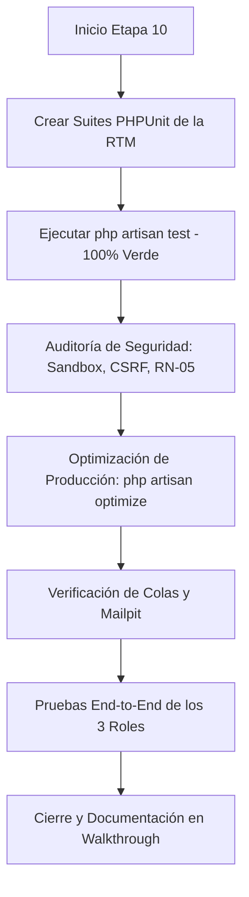

# Plan de Implementación: Etapa 10 — Versión Objetiva Completa (Tests, Seguridad y Cierre)

## 1. Contexto y Objetivos de la Etapa
Habiendo concluido exitosamente las Etapas 1 a 9, la **Etapa 10** representa el **cierre integral y aseguramiento de calidad de Artfolio**. El objetivo es garantizar que cada especificación funcional y técnica del documento maestro esté completamente validada mediante una batería exhaustiva de tests automatizados, una auditoría final de seguridad y la ejecución estructurada de los tres flujos de usuario (*Visitante*, *Artista*, *Administrador*):

1. **Batería de Tests PHPUnit según la Matriz de Trazabilidad de Requerimientos (RTM):**
   - `ArtworkEmbedTest`: Verificación de la whitelist estricta, rechazo de dominios maliciosos y mitigación anti-SSRF (**RF-02**, **RN-01**).
   - `ExplorerSearchTest`: Buscador multi-criterio (título, descripción, técnica, autor), filtrado por categoría y paginación (**RF-07**).
   - `GuestInterceptorTest`: Verificación de protección de endpoints autenticados y presencia de interceptores contextuales para invitados (**RF-08**).
   - `AdminManualReportTest`: Ciclo completo de moderación de reportes, ocultación inmediata y encolado de alerta por enlace caído (**RF-09**, **RN-02**).
   - `TrashIndependentTest`: Comportamiento de la papelera con `SoftDeletes`, desvinculación de colecciones huérfanas y restauración independiente (**RF-10**, **RN-03**).
   - `AdminSeederTest`: Aprovisionamiento idempotente de la cuenta administradora inicial desde variables de entorno (**RF-12**).
2. **Auditoría de Seguridad Exhaustiva:**
   - Atributos `sandbox` en todos los iframes multimedia para aislar ejecución de scripts no autorizados.
   - Protección CSRF universal en todas las peticiones con mutación de estado.
   - Verificación de la regla **RN-05**: Anti-suplantación en contacto seguro (remitente autenticado y validado).
   - Sanitización de entradas y escape contextual contra Cross-Site Scripting (XSS).
3. **Rendimiento, Optimización y Colas:**
   - Verificación del comando `php artisan optimize` (`config:cache`, `route:cache`, `view:cache`).
   - Verificación de la cola de mensajería con Mailpit en puerto 1025 / UI 8025.
   - Auditoría de logs en `storage/logs/laravel.log` para confirmar cero advertencias residuales.
4. **Validación de Flujos de Usuario End-to-End (E2E):**
   - **Flujo 1 (Visitante):** Navegación fluida por galería, filtrado de obras, visor modal adaptativo e interceptor modal contextual.
   - **Flujo 2 (Artista):** Registro, personalización de avatar con drag-to-crop interactivo, publicación de obra multimedia, gestión de colecciones y papelera.
   - **Flujo 3 (Administrador):** Dashboard con métricas globales en tiempo real, resolución de reportes con alerta de enlace caído y gestión de usuarios/papelera global.

---

## 2. Requerimientos y Reglas de Negocio Cubiertos

| Código | Requerimiento / Regla | Foco de Validación en Etapa 10 |
| :--- | :--- | :--- |
| **RF-02** | Whitelist e Integración Multimedia | Suite `ArtworkEmbedTest` valida dominios autorizados y bloqueo de URLs inválidas o peligrosas. |
| **RF-07** | Buscador y Filtros de Galería | Suite `ExplorerSearchTest` valida búsqueda insensible a mayúsculas, filtros por categoría y paginación. |
| **RF-08** | Interceptor de Visitantes | Suite `GuestInterceptorTest` valida rechazo HTTP 401/403 en backend y modal contextual en frontend. |
| **RF-09** | Reportes de Enlace Caído | Suite `AdminManualReportTest` valida prevención de reportes duplicados y ciclo de vida del ticket. |
| **RF-10** | Papelera y Ciclo de Vida | Suite `TrashIndependentTest` valida regla **RN-03** (restauración sin colecciones eliminadas) y purga a 30 días. |
| **RF-12** | Panel y Seeding Administrativo | Suite `AdminSeederTest` valida credenciales iniciales de `.env` y acceso restringido con middleware `admin`. |
| **RN-01** | Whitelist Estricta | Verificación del extractor unificado y regex de validación contra bypasses (IPs privadas, subdominios falsos). |
| **RN-02** | Moderación Manual y Alerta | Verificación de transición automática a `hidden`, resolución de reporte y encolado de `SendLinkDownAlert`. |
| **RN-03** | Restauración Independiente | Verificación de que una obra restaurada cuya colección sigue eliminada mantenga consistencia relacional. |
| **RN-05** | Anti-suplantación en Contacto | Confirmación de que el remitente del mensaje de contacto sea exclusivamente el usuario autenticado. |

---

## 3. Plan Detallado de Implementación

### Fase 1: Creación de la Batería de Tests Automatizados PHPUnit

#### 1.1 `tests/Feature/ArtworkEmbedTest.php`
- **Casos de prueba:**
  1. Permite registrar obras con URLs de proveedores permitidos (YouTube, Spotify, Sketchfab, DeviantArt, Pinterest, Google Docs).
  2. Rechaza URLs de dominios no autorizados (ej. `malicious-site.com`, `phishing.net`) con mensaje de validación amigable.
  3. Rechaza intentos de evasión SSRF (ej. `localhost`, `127.0.0.1`, `169.254.169.254`, `http://[::1]`).
  4. Extrae y almacena correctamente el `provider`, `category` y `embed_html` según la URL provista.

#### 1.2 `tests/Feature/ExplorerSearchTest.php`
- **Casos de prueba:**
  1. Retorna obras publicadas en la galería pública sin requerir autenticación.
  2. Filtra obras por término de búsqueda (coincidencia en título y descripción).
  3. Filtra obras por categoría (`3d`, `video`, `audio`, `image`, `doc`).
  4. No muestra obras en estado `draft`, `hidden` o enviadas a la papelera (`SoftDeletes`).
  5. Paginación de resultados consistente.

#### 1.3 `tests/Feature/GuestInterceptorTest.php`
- **Casos de prueba:**
  1. Petición no autenticada a `POST /obras/{id}/bookmark` redirige al login o devuelve respuesta denegada.
  2. Petición no autenticada a `POST /artista/{slug}/contact` rechaza con estado HTTP 401 o redirección.
  3. Petición no autenticada a `POST /obras/{id}/report` rechaza con estado HTTP 401 o redirección.
  4. La vista principal incluye el componente `<x-guest-modal>` configurado para interceptar acciones.

#### 1.4 `tests/Feature/AdminManualReportTest.php`
- **Casos de prueba:**
  1. Usuario autenticado puede enviar un reporte de obra; no permite reportes duplicados pendientes (**RF-09**).
  2. Usuario no administrador no puede acceder a las rutas de administración (`GET /admin/*` devuelve 403).
  3. Administrador visualiza el reporte en la bandeja de pendientes.
  4. Acción `linkDownAlert`: cambia la obra a `hidden`, marca el reporte como `resolved` y despacha el Job `SendLinkDownAlert` (**RN-02**).

#### 1.5 `tests/Feature/TrashIndependentTest.php`
- **Casos de prueba:**
  1. Al eliminar una obra, se marca con `deleted_at` sin eliminarse físicamente de la base de datos.
  2. Al eliminar una colección que contiene obras, las obras permanecen intactas en la galería personal.
  3. Al enviar una colección y una obra a la papelera, y restaurar solo la obra, se desvincula de la colección huérfana (**RN-03**).
  4. La purga con `Artisan::call('model:prune')` elimina registros con más de 30 días de antigüedad.

#### 1.6 `tests/Feature/AdminSeederTest.php`
- **Casos de prueba:**
  1. El comando `db:seed` crea o actualiza la cuenta administradora configurada en el archivo `.env`.
  2. La ejecución repetida del seeder es idempotente (no duplica registros ni altera contraseñas existentes indebidamente).
  3. El usuario creado posee la bandera `is_admin = true` y estado `active`.

---

### Fase 2: Auditoría y Refuerzo de Seguridad
1. **Inspección de iframes (`sandbox`):**
   - Auditar [resources/views/components/viewer-modal.blade.php](file:///c:/laragon/www/germanBianchi_artfolio/resources/views/components/viewer-modal.blade.php) y [EmbedService.php](file:///c:/laragon/www/germanBianchi_artfolio/app/Services/EmbedService.php).
   - Asegurar presencia estricta de `sandbox="allow-scripts allow-same-origin allow-presentation"` y `loading="lazy"`.
2. **Protección Anti-suplantación en Contacto ([ContactController.php](file:///c:/laragon/www/germanBianchi_artfolio/app/Http/Controllers/ContactController.php)):**
   - Confirmar que el remitente (`sender_email`, `sender_name`) se extrae únicamente de `auth()->user()`.
   - Verificar bloqueo de auto-contacto (`auth()->id() === $artist->id`).
3. **Revisión de Cabeceras y Tokens CSRF:**
   - Verificar directiva `@csrf` en todos los formularios Blade y meta-tag `csrf-token` en peticiones AJAX/Fetch.

---

### Fase 3: Optimización y Verificación de Entorno
1. **Optimización con Artisan:**
   - Ejecutar `php artisan optimize:clear` seguido de `php artisan optimize` para validar la compilación limpia de rutas, configuración y plantillas.
2. **Verificación del Sistema de Colas:**
   - Probar procesamiento de trabajos con `php artisan queue:work --once` contra el servidor Mailpit (puertos 1025 y 8025).
3. **Auditoría de Logs:**
   - Inspeccionar [storage/logs/laravel.log](file:///c:/laragon/www/germanBianchi_artfolio/storage/logs/laravel.log) para descartar advertencias, queries no optimizados o errores latentes.

---

### Fase 4: Protocolo de Demostración E2E de los 3 Roles
1. **Visitante:**
   - Carga inicial de la galería sin credenciales.
   - Búsqueda de obras por término y filtrado por categoría multimedia.
   - Apertura del visor modal interactivo.
   - Intento de acción protegida (guardar favorito / contactar) -> activación del `<x-guest-modal>` contextual.
2. **Artista:**
   - Acceso con cuenta de artista.
   - Actualización de perfil con encuadre de avatar interactivo drag-to-crop y estado de comisiones.
   - Publicación de una obra multimedia con enlace verificado.
   - Creación de una colección y asignación de obra.
   - Eliminación lógica a la papelera y posterior restauración.
3. **Administrador:**
   - Acceso al panel administrativo `/admin`.
   - Revisión de KPIs globales y contadores de colas.
   - Gestión de un reporte recibido: aplicación de la regla de enlace caído (obra pasa a `hidden`, correo de alerta enviado a Mailpit).
   - Verificación de la papelera global y opciones de moderación de usuarios.

---

## 4. Plan de Verificación y Criterios de Aceptación

### Criterios de Aceptación:
- [x] Las 6 suites de tests de la RTM están creadas en `tests/Feature/` y pasan al 100% en `php artisan test`.
- [x] Cero vulnerabilidades detectadas en la carga de iframes, formularios y endpoints de contacto.
- [x] `php artisan optimize` compila sin errores ni advertencias de rutas/configuraciones.
- [x] El worker de colas y Mailpit procesan y reciben correctamente las notificaciones.
- [x] La plataforma completa queda lista para demostración y puesta en producción local.
