# Plan de Implementación: Etapa 9 — Funcionalidades Avanzadas de UI y Refinamiento Estético

## 1. Contexto y Objetivos de la Etapa
Habiendo completado la arquitectura central, los extractores multimedia, la papelera inteligente, el sistema de contacto seguro y el panel de administración backoffice (Etapas 1 a 8), la **Etapa 9** se concentra en la **excelencia de interfaz (UI), experiencia de usuario (UX) y fidelidad estética**, conforme a los requerimientos maestros **RF-01** (Avatar Drag-to-Crop), **RF-08** (Modal Interceptor para Visitantes) y **RNF-05** (Rendimiento Frontend y Fluidez a 60 FPS):

1. **Avatar Drag-to-Crop Interactivo (RF-01):** Componente avanzado en Alpine.js que permite al artista introducir una URL externa de imagen, encuadrarla interactivamente mediante arrastre ($X/Y$), graduar el zoom mediante slider o rueda del ratón (`wheel`), y persistir las coordenadas en la base de datos sin subir ningún archivo binario al servidor.
2. **Componente Reutilizable `<x-user-avatar />`:** Estandarización del renderizado del avatar con estilos CSS de crop (`transform: translate(X%, Y%) scale(Zoom)`) y fallback visual de iniciales con gradientes artísticos si la URL remota falla o no está configurada.
3. **Completitud del Perfil de Artista:** Incorporación de los campos `bio` (biografía artística con contador de caracteres) y `commission_status` (estado de comisiones: *Abierto*, *Cerrado*, *A consultar*) en el formulario de edición de perfil ([update-profile-information-form.blade.php](file:///c:/laragon/www/germanBianchi_artfolio/resources/views/profile/partials/update-profile-information-form.blade.php)) y en [ProfileUpdateRequest.php](file:///c:/laragon/www/germanBianchi_artfolio/app/Http/Requests/ProfileUpdateRequest.php).
4. **Modal Interceptor Contextual para Visitantes (RF-08):** Enriquecimiento de `<x-guest-modal />` para reaccionar con mensajes personalizados según la acción bloqueada (*"Inicia sesión para guardar en favoritos"*, *"Inicia sesión para contactar al artista"*, *"Inicia sesión para reportar una obra"*), preservando la URL actual de retorno.
5. **Refinamiento Estético Global (Design Aesthetics & Dark Mode):**
   * Incorporación de tipografía Google Fonts premium (*Inter* para lectura y *Outfit* para títulos e identidad de marca).
   * Sistema de color contrastado y pulido para Modo Claro y Modo Oscuro (cumplimiento de contraste accesible WCAG AA).
   * Micro-animaciones, elevación de tarjetas, resplandores sutiles en hover y badges cromáticos oficiales de proveedores multimedia.
6. **Responsividad Extrema:** Verificación y ajuste de navegación táctil, modales y cuadrículas en smartphones, tablets y pantallas de escritorio de alta resolución.

---

## 2. Requerimientos y Reglas de Negocio Aplicables

| Código | Requerimiento / Regla | Aplicación en la Etapa 9 |
| :--- | :--- | :--- |
| **RF-01** | **Perfil y Avatar Drag-to-Crop** | Arrastre interactivo ($X/Y$) con ratón y pantallas táctiles, control de zoom (slider y wheel), persistencia de `crop_x`, `crop_y`, `crop_zoom`. Cero binarios en servidor; fallback de iniciales si la URL remota falla. |
| **RF-08** | **Modal Interceptor para Visitantes** | Ventana emergente reactiva en Alpine.js al intentar guardar, contactar o reportar sin autenticación. Mantiene el contexto de navegación sin redirecciones forzadas y con mensajes contextuales. |
| **RNF-05** | **Rendimiento Frontend** | Reactividad fluida con Alpine.js sin recargas de página completas; transiciones a 60 FPS y bundle CSS/JS optimizado. |
| **RN-05** | **Anti-Suplantación y Contacto** | Reforzar visualmente el estado del formulario de contacto y el badge de remitente verificado en perfiles ajenos. |
| **RN-06** | **Privacidad de Guardados** | Interceptor de visitantes protegiendo la acción de favoritos sin exponer contadores públicos ni likes. |

---

## 3. Diagrama de Interacción UI — Avatar Drag-to-Crop y Modal Interceptor

```mermaid
flowchart TD
    subgraph S1 ["Flujo 1: Avatar Drag-to-Crop (RF-01)"]
        A[Artista en /profile] --> B[Introduce URL externa de imagen]
        B --> C[Alpine.js carga imagen en visor circular]
        C --> D[Artista arrastra X/Y con ratón o touch]
        C --> E[Artista gradúa Zoom con slider o rueda wheel]
        D & E --> F[Valores reactivos crop_x, crop_y, crop_zoom]
        F --> G[Clic en Guardar Perfil]
        G --> H[(users table: avatar_url, crop_x, crop_y, crop_zoom)]
        H --> I[Componente <x-user-avatar /> refleja encuadre en toda la plataforma]
    end

    subgraph S2 ["Flujo 2: Modal Interceptor para Visitantes (RF-08)"]
        J[Visitante no autenticado] --> K{Acción Restringida}
        K -->|Clic en Guardar| L["$dispatch('open-guest-modal', { context: 'favorito' })"]
        K -->|Clic en Contactar| M["$dispatch('open-guest-modal', { context: 'contacto' })"]
        K -->|Clic en Reportar| N["$dispatch('open-guest-modal', { context: 'reporte' })"]
        L & M & N --> O[Modal Interceptor emerge sobre la pantalla actual]
        O --> P[Mensaje contextual + Botones Iniciar Sesión / Registro con redirect_to]
        P --> Q[Visitante no pierde su posición ni recarga la página]
    end
```



---

## 4. Desglose Técnico por Bloques de Implementación

### BLOQUE 1: Drag-to-Crop Avatar Interactivo & Perfil del Artista (RF-01)

#### 1.1. Visor Circular Interactivo en Alpine.js
* Refactorizar el bloque de avatar en [resources/views/profile/partials/update-profile-information-form.blade.php](file:///c:/laragon/www/germanBianchi_artfolio/resources/views/profile/partials/update-profile-information-form.blade.php):
  * Soporte dual de eventos: ratón (`mousedown`, `mousemove`, `mouseup`) y pantallas táctiles móviles (`touchstart`, `touchmove`, `touchend`).
  * Soporte de zoom con rueda de ratón (`@wheel.prevent="onWheel"`): permite acercar o alejar el avatar deslizando la rueda sobre el círculo.
  * Botón rápido *"Restablecer Encuadre"*: regresa inmediatamente a `cropX = 0`, `cropY = 0`, `cropZoom = 1`.
  * Rango de zoom de 0.5x a 4.0x con visualizador numérico en vivo (ej. `1.25x`).
  * Indicador de carga de imagen y detección de errores en URL remota (si la imagen falla, muestra aviso y regresa al fallback de iniciales).

#### 1.2. Componente Blade Unificado `<x-user-avatar />`
* Crear [resources/views/components/user-avatar.blade.php](file:///c:/laragon/www/germanBianchi_artfolio/resources/views/components/user-avatar.blade.php):
  * Props: `:user`, `size` (`xs`, `sm`, `md`, `lg`, `xl`), `class`.
  * Si `user->avatar_url` está configurado:
    * Contenedor con relación de aspecto circular (`rounded-full overflow-hidden`).
    * Fondo con `background-image` y transformaciones CSS exactas:
      ```css
      transform: translate({{ $user->crop_x ?? 0 }}%, {{ $user->crop_y ?? 0 }}%) scale({{ $user->crop_zoom ?? 1 }});
      ```
  * Si `avatar_url` es nulo o falla la carga:
    * Fallback con inicial del nombre en negrita sobre un fondo artístico con degradado temático (`from-indigo-500 to-purple-600`).
  * Reemplazar todas las repeticiones ad-hoc de código de avatar en:
    * Barra de navegación superior ([layouts/navigation.blade.php](file:///c:/laragon/www/germanBianchi_artfolio/resources/views/layouts/navigation.blade.php)).
    * Perfil público del artista ([profile/show.blade.php](file:///c:/laragon/www/germanBianchi_artfolio/resources/views/profile/show.blade.php)).
    * Visor modal de obras ([components/viewer-modal.blade.php](file:///c:/laragon/www/germanBianchi_artfolio/resources/views/components/viewer-modal.blade.php)).
    * Tablas y menús del panel de administración ([admin/users/index.blade.php](file:///c:/laragon/www/germanBianchi_artfolio/resources/views/admin/users/index.blade.php), [layouts/admin.blade.php](file:///c:/laragon/www/germanBianchi_artfolio/resources/views/layouts/admin.blade.php)).

#### 1.3. Incorporación de Biografía y Estado de Comisiones en el Perfil
* **Formulario de Edición ([update-profile-information-form.blade.php](file:///c:/laragon/www/germanBianchi_artfolio/resources/views/profile/partials/update-profile-information-form.blade.php)):**
  * Campo de texto multilínea `bio` (Biografía del Artista) con contador interactivo de caracteres (máx. 1000).
  * Selector desplegable `commission_status` con opciones:
    * `open`: *"Abierto a Comisiones / Encargos"* (Badge verde en perfil).
    * `consult`: *"Consultar Disponibilidad"* (Badge azul en perfil).
    * `closed`: *"Comisiones Cerradas Actualmente"* (Badge gris en perfil).
* **Validación Backend ([ProfileUpdateRequest.php](file:///c:/laragon/www/germanBianchi_artfolio/app/Http/Requests/ProfileUpdateRequest.php)):**
  * Reglas para `bio` (`nullable|string|max:1000`).
  * Reglas para `commission_status` (`nullable|string|in:open,closed,consult`).

---

### BLOQUE 2: Modal Interceptor Contextual para Visitantes (RF-08)

#### 2.1. Enriquecimiento del Componente `<x-guest-modal />`
* Mejorar [resources/views/components/guest-modal.blade.php](file:///c:/laragon/www/germanBianchi_artfolio/resources/views/components/guest-modal.blade.php):
  * Soporte para recibir parámetros en el evento `@open-guest-modal.window`:
    ```javascript
    $event.detail = {
        title: 'Guarda tus obras favoritas',
        message: 'Crea tu colección privada y accede a tus creaciones preferidas en cualquier momento.',
        action: 'bookmark'
    }
    ```
  * Textos e iconos dinámicos según el contexto:
    * **Favoritos:** Icono de corazón, título *"Guarda tus obras favoritas"*, mensaje de privacidad absoluta.
    * **Contacto:** Icono de sobre/correo, título *"Contacta directamente con el artista"*, mensaje de comunicación segura.
    * **Reporte:** Icono de bandera/escudo, título *"Ayúdanos a moderar la comunidad"*, mensaje sobre reporte ciudadano.
    * **General:** Fallback informativo estándar de bienvenida a Artfolio.
  * Botones "Iniciar Sesión" y "Registrarse" con parámetro `?redirect=...` apuntando a la URL actual (`url()->current()`) para que tras iniciar sesión el usuario vuelva al mismo lugar sin desorientarse.
  * Tecla `Escape` y clic fuera del panel para cerrar el modal suavemente.

---

### BLOQUE 3: Ecosistema Visual, Tipografía y Modo Oscuro (Design Aesthetics)

#### 3.1. Tipografía Google Fonts y Jerarquía Textual
* Añadir en las cabeceras HTML (`layouts/app.blade.php` y `layouts/admin.blade.php`) la carga optimizada con `preconnect`:
  * Familia **Outfit** (pesos 600, 700, 800) para logotipos, títulos, números de métricas y encabezados destacados.
  * Familia **Inter** / **Figtree** (pesos 400, 500, 600) para textos de lectura continua, descripciones y controles de interfaz.
* Configuración de fuentes en `tailwind.config.js` y `resources/css/app.css` para aplicar clases utilitarias limpias (`font-sans`, `font-display`).

#### 3.2. Refinamiento de Modo Oscuro y Contraste (WCAG AA)
* Auditoría de contraste en fondos y bordes:
  * Fondos: unificación en `bg-gray-50` (modo claro) y `bg-gray-950` / `bg-gray-900` (modo oscuro).
  * Bordes: reemplazo de contrastes duros por sutiles divisores `border-gray-200/80` y `border-gray-800/80`.
  * Superficies elevadas: uso de tarjetas con ligero resplandor (*glow effect*) y sombras elegantes (`shadow-sm`, `hover:shadow-md`).

#### 3.3. Micro-interacciones en Tarjetas de Galería ([artwork-card.blade.php](file:///c:/laragon/www/germanBianchi_artfolio/resources/views/components/artwork-card.blade.php))
* Efecto hover con zoom sutil de miniatura (`group-hover:scale-105 duration-300`).
* Badges de proveedor multimedia con identidad cromática oficial:
  * YouTube: rojo `#FF0000`.
  * Spotify: verde `#1DB954`.
  * Sketchfab: cian `#1CAAD9`.
  * DeviantArt: verde neón `#00E59B`.
  * Pinterest: carmesí `#E60023`.
  * Google Docs: azul `#4285F4`.
* Botón de favorito con animación de pulso reactivo al marcar/desmarcar.

---

### BLOQUE 4: Adaptabilidad Responsive Extrema (Móvil, Tablet y Desktop)
* **Galería Pública:** Cuadrícula fluida `grid-cols-1 sm:grid-cols-2 lg:grid-cols-3 xl:grid-cols-4` con espaciado consistente.
* **Visor Modal:** Vista en columna vertical adaptada a pantallas táctiles en móviles (`flex-col`), garantizando que los reproductores multimedia (YouTube, Spotify, etc.) no desborden la pantalla y los botones de acción sean cómodamente pulsables con el pulgar.
* **Perfil de Artista:** Encabezado centrado en móvil y horizontal en desktop, pestañas de navegación con scroll horizontal táctil si exceden el ancho.

---

## 5. Matriz de Archivos a Crear y Modificar

| Tipo | Archivo | Acción / Responsabilidad |
| :--- | :--- | :--- |
| **Componente** | `resources/views/components/user-avatar.blade.php` *(Nuevo)* | Componente reutilizable de avatar con transformaciones CSS de crop y fallback de iniciales. |
| **Form Request**| [app/Http/Requests/ProfileUpdateRequest.php](file:///c:/laragon/www/germanBianchi_artfolio/app/Http/Requests/ProfileUpdateRequest.php) | Validar campos `bio` y `commission_status` junto al avatar y coordenadas de crop. |
| **Vista Parcial**| [resources/views/profile/partials/update-profile-information-form.blade.php](file:///c:/laragon/www/germanBianchi_artfolio/resources/views/profile/partials/update-profile-information-form.blade.php) | Drag-to-crop interactivo con touch, wheel zoom, botón reset, inputs de bio y comisiones. |
| **Componente** | [resources/views/components/guest-modal.blade.php](file:///c:/laragon/www/germanBianchi_artfolio/resources/views/components/guest-modal.blade.php) | Interceptor reactivo enriquecido con mensajes contextuales dinámicos y redirección preservada. |
| **Vista Perfil** | [resources/views/profile/show.blade.php](file:///c:/laragon/www/germanBianchi_artfolio/resources/views/profile/show.blade.php) | Adopción de `<x-user-avatar>`, badges refinados de comisiones y diseño responsivo. |
| **Componente** | [resources/views/components/artwork-card.blade.php](file:///c:/laragon/www/germanBianchi_artfolio/resources/views/components/artwork-card.blade.php) | Micro-animaciones, badges oficiales de proveedores y adopción del avatar estandarizado. |
| **Componente** | [resources/views/components/viewer-modal.blade.php](file:///c:/laragon/www/germanBianchi_artfolio/resources/views/components/viewer-modal.blade.php) | Adopción de `<x-user-avatar>`, visor adaptativo móvil y disparadores de interceptor. |
| **Layouts** | [resources/views/layouts/app.blade.php](file:///c:/laragon/www/germanBianchi_artfolio/resources/views/layouts/app.blade.php)<br>[resources/views/layouts/admin.blade.php](file:///c:/laragon/www/germanBianchi_artfolio/resources/views/layouts/admin.blade.php) | Carga optimizada de Google Fonts (*Outfit* / *Inter*), estilos globales y modo oscuro consistente. |
| **Navegación** | [resources/views/layouts/navigation.blade.php](file:///c:/laragon/www/germanBianchi_artfolio/resources/views/layouts/navigation.blade.php) | Integración de `<x-user-avatar>` en dropdown de usuario móvil y escritorio. |

---

## 6. Plan de Pruebas y Validación Integral

| Prueba | Acción Realizada | Resultado Esperado | Criterio de Éxito |
| :--- | :--- | :--- | :--- |
| **1. Avatar Drag-to-Crop (Mouse)** | Arrastrar imagen circular con el cursor y mover slider de zoom en `/profile`. | Las coordenadas `crop_x`, `crop_y` y `crop_zoom` se actualizan en vivo. | Transformación CSS fluida |
| **2. Avatar Zoom con Rueda (Wheel)** | Desplazar rueda del ratón sobre el avatar. | El zoom aumenta o disminuye gradualmente sin desbordar el contenedor. | Reactividad a 60 FPS |
| **3. Persistencia de Perfil (RF-01)** | Guardar cambios en el formulario de perfil. | Se persisten `avatar_url`, coordenadas de crop, `bio` y `commission_status`. | HTTP 302 / Flash "Saved." |
| **4. Fallback de Avatar con Iniciales** | Usuario sin `avatar_url` o con URL inválida. | Muestra círculo artístico con la inicial del artista sobre fondo degradado. | Fallback visual limpio |
| **5. Interceptor en Favoritos (RF-08)** | Visitante pulsa "Guardar" en tarjeta de galería o visor modal. | Se abre `<x-guest-modal>` con mensaje específico de favoritos sin recargar la página. | Contexto intacto |
| **6. Interceptor en Contacto (RF-08)** | Visitante pulsa "Contactar al Artista" en perfil público. | Se abre `<x-guest-modal>` con mensaje específico de contacto seguro. | Sin redirección brusca |
| **7. Interceptor en Reporte (RF-08)** | Visitante pulsa "Reportar Obra" en visor modal. | Se abre `<x-guest-modal>` indicando iniciar sesión para moderar. | Modal visible y funcional |
| **8. Consistencia de Modo Oscuro** | Alternar entre tema claro y oscuro en todas las vistas. | Todos los textos, bordes y tarjetas mantienen contraste óptimo sin elementos ilegibles. | WCAG AA cumplido |
| **9. Compilación de Assets** | Ejecutar `npm run build`. | Vite compila los assets sin advertencias ni errores en CSS o JS. | Build exitoso en < 1s |

---

## 7. Siguientes Pasos
Una vez aprobado este plan:
1. Crear el componente unificado `<x-user-avatar />`.
2. Actualizar `ProfileUpdateRequest` y perfeccionar el drag-to-crop interactivo con rueda de ratón, touch y campos `bio` / `commission_status`.
3. Enriquecer el modal interceptor `<x-guest-modal />` con mensajes dinámicos contextuales.
4. Integrar Google Fonts (*Outfit* / *Inter*) y pulir contrastes en modo claro/oscuro.
5. Ejecutar la batería de pruebas en navegador y verificar compilación con `npm run build`.
