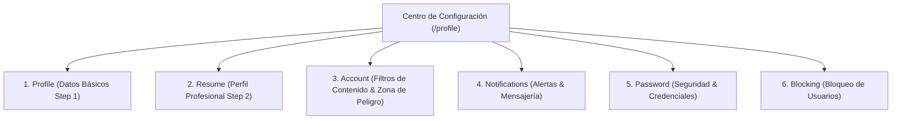

# Plan de Integración: Centro de Configuración y Gestión de Perfil por Pestañas (Estilo ArtStation Settings Hub)

> **Documento de Referencia:** `A_Textos/Artfolio_Diagnostico_Mejoras_y_Nuevas_Funciones.pdf` (Ítem #2 de la Lista 2 — Prioridad P1 Inmediata / Alto Impacto)  
> **Diseño de Referencia:** `A_Textos/Art_profileTab1.png` (ArtStation Settings Panel)

---

## 1. Objetivo General
Transformar la vista existente de edición de perfil (`/profile`), que actualmente presenta un formulario vertical genérico de Laravel Breeze, en un **Centro Integral de Configuración y Gestión de Perfil por Pestañas laterales** (*Settings & Profile Hub*). 

Este centro será el destino natural donde el artista podrá consultar, editar y expandir en cualquier momento la información configurada previamente durante el Onboarding inicial, además de gestionar sus preferencias de privacidad, seguridad y filtros de contenido.

---

## 2. Pestañas y Alcance Funcional

Conforme a lo especificado y descartando los módulos comerciales (*Job Preferences, Social and Freelance, Billing, Subscriptions*), el panel se organizará en **6 pestañas modulares**:

### 👤 Pestaña 1: Profile (Información Básica)
- **Datos editables:** Nombre, Titular profesional (*Headline*), Ciudad, País (con el buscador reactivo inteligente de 250 países ya implementado).
- **Avatar:** Editor interactivo con zoom y centrado (estilo Discord) y URL web.
- **Imagen de Portada (Cover Banner):** Campo para ingresar URL de banner panorámico (1920x640) para la cabecera del portafolio público.
- **Acciones:** Botón principal de guardado *"Save"* y acceso directo superior *"View profile ↗"* que abre `/artista/{slug}` en pestaña nueva.

### 📄 Pestaña 2: Resume (Perfil Profesional)
- **Identidad pública:** Slug / Handle de usuario (`/artista/{slug}`) con comprobación de unicidad.
- **Biografía / Resumen:** Área de texto con contador dinámico de caracteres (mínimo 20, máximo 1000).
- **Disciplinas y Habilidades (*Skills*):** Selector interactivo de etiquetas en Alpine.js con chips de sugerencias rápidas.
- **Herramientas de Trabajo (*Software*):** Selector interactivo de herramientas (Blender, Photoshop, etc.).
- **Disponibilidad de Comisiones:** Selector por tarjetas (*Open*, *Consult First*, *Closed*).
- **Modalidades de Trabajo:** Oportunidades deseadas (*Full-time*, *Contract*, *Freelance*).
- **Correo de Contacto:** Selector para mostrar correo con alternativa de cuenta o correo personalizado.

### ⚙️ Pestaña 3: Account (Preferencias de Contenido y Cuenta)
- **Filtros de Navegación y Calidad de Vida (QoL):**
  - Switch: *"Mostrar contenido maduro (+18 / Sensible)"* (desactivado por defecto).
  - Switch: *"No mostrar obras generadas por IA / Ocultar arte IA"* (desactivado por defecto).
- **Zona de Peligro:**
  - Formulario y modal de confirmación con contraseña para eliminación permanente o baja de la cuenta.

### 🔔 Pestaña 4: Notifications (Alertas de Plataforma)
- **Preferencias de Notificación:**
  - Switch: *"Notificarme cuando los artistas que sigo publiquen nuevas obras"*.
  - Switch: *"Notificarme al recibir mensajes o solicitudes de comisión"*.

### 🔒 Pestaña 5: Password (Seguridad)
- Actualización de contraseña mediante los campos actuales de Breeze: Contraseña actual, Nueva contraseña y Confirmación con validación estricta.

### 🚫 Pestaña 6: Blocking (Gestión de Bloqueos)
- Campo de entrada para escribir el nombre de usuario (`@username`) a bloquear.
- Lista interactiva de usuarios bloqueados actualmente con botón *"Unblock"*.
- Las obras y contenidos de los usuarios bloqueados se filtran del explorador para el usuario que los bloqueó.

---

## 3. Plan de Trabajo en 4 Fases

1. **Fase 1: Base de Datos y Modelo:**
   - Migración para añadir en `users`: `banner_url`, `show_mature_content`, `hide_ai_content`, `notify_new_artworks`, `notify_messages`.
   - Creación de tabla pivote `user_blocks` (`id`, `user_id`, `blocked_user_id`, `created_at`).
   - Actualización de `$fillable`, relaciones y helpers en [`User.php`](file:///c:/laragon/www/germanBianchi_artfolio/app/Models/User.php).

2. **Fase 2: Arquitectura del Layout y Pestañas Principales (`Profile` y `Resume`):**
   - Rediseño de [`resources/views/profile/edit.blade.php`](file:///c:/laragon/www/germanBianchi_artfolio/resources/views/profile/edit.blade.php) en estructura de 2 columnas: Sidebar fija con tarjeta de usuario (*Avatar, Nombre, Member since*) y navegación de pestañas laterales con Alpine.js.
   - Conexión de las pestañas 1 (*Profile*) y 2 (*Resume*) reutilizando los componentes ya creados en el onboarding.

3. **Fase 3: Pestañas de Seguridad y Preferencias (`Account`, `Notifications` y `Password`):**
   - Integración de los switches de contenido IA y +18.
   - Pestaña Password aislada.
   - Ajustes de notificaciones.

4. **Fase 4: Pestaña `Blocking`, Filtro en Explorador y Suite de Pruebas:**
   - Controlador y rutas para bloquear/desbloquear usuarios.
   - Filtrado en [`ExplorerController.php`](file:///c:/laragon/www/germanBianchi_artfolio/app/Http/Controllers/ExplorerController.php).
   - Creación de pruebas automatizadas en `tests/Feature/SettingsHubTest.php`.

---

## 4. Estado de Implementación: Completado al 100% ✅
- **Base de Datos & Modelos:** Migración `add_settings_and_user_blocks_tables` ejecutada. Modelo `User` con fillable, casts y relaciones `blockedUsers()`, `blockedByUsers()`, `isBlocking()`, `block()`, `unblock()`.
- **UI & Layout:** `resources/views/profile/edit.blade.php` transformado a arquitectura de 2 columnas estilo ArtStation con navegación por 6 pestañas modulares (`tab-profile`, `tab-resume`, `tab-account`, `tab-notifications`, `tab-password`, `tab-blocking`). Reutilización de los mejores componentes (selector reactivo de 250 países, editor de avatar pan & zoom, selector de software y disciplinas, comprobación en vivo de handle).
- **Banner de Portada:** Campo `banner_url` integrado en `tab-profile` con previsualización en vivo y cabecera en el portafolio público (`profile/show.blade.php`).
- **Flags de IA y Subcategorías en Obras:** Migración `add_subcategory_and_ai_flag_to_artworks_table`, selector interactivo en create/edit, badge `[AI]` en tarjetas y visor modal, y filtro activo en el explorador.
- **Suite de Pruebas:** 80 tests ejecutados y pasando al 100% (`ArtworkSubcategoryAndAiTest`, `SettingsHubTest`, `UserSuspensionTest`, etc.).

