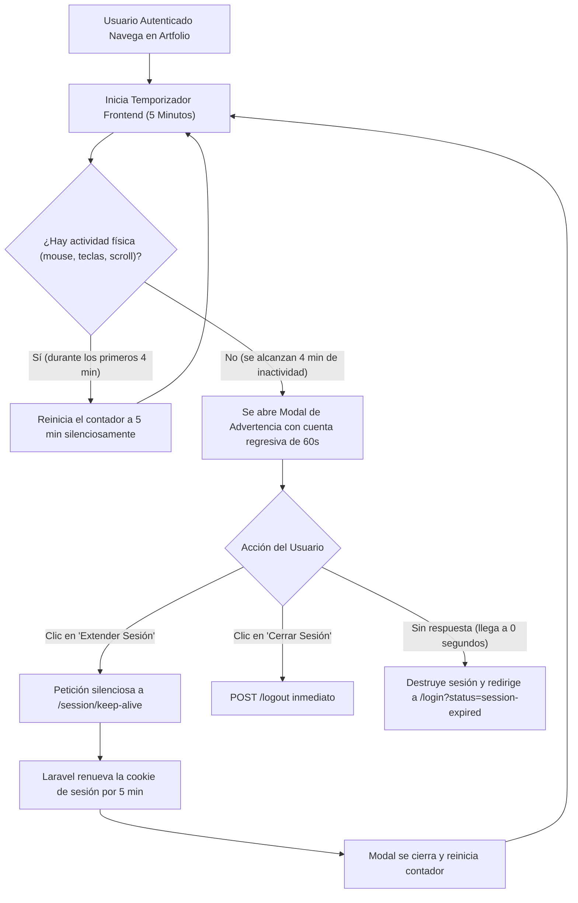

# Plan de Implementación: Control de Inactividad de Sesión y Extensión Dinámica (Session Timeout & Keep-Alive)

## 1. Visión General del Requerimiento

El objetivo es incorporar un mecanismo de seguridad de nivel profesional que limite la sesión activa a **5 minutos de inactividad**. Para no perjudicar la experiencia de usuario (por ejemplo, si el artista está leyendo o redactando una descripción), el sistema debe:

1. **Detectar inactividad del lado del cliente** (falta de interacción física: teclado, ratón, scroll).
2. **Desplegar un aviso previo interactivo** (por ejemplo, al minuto 4:00, dando 60 segundos de cuenta regresiva).
3. **Ofrecer preguntas/opciones claras**:
   - Botón **"Keep me signed in" (Extender 5 minutos más)**: Renueva la sesión de inmediato en el servidor sin recargar la página.
   - Botón **"Sign out now" (Cerrar sesión ahora)**: Cierra la sesión y redirige de forma limpia.
4. **Auto-cierre seguro**: Si el usuario no responde y el contador llega a 0, se destruye la sesión y se le redirige al login informando la causa (*"Your session has expired due to inactivity"*).

---

## 2. Diagrama de Flujo



---

## 3. Fases Detalladas de Implementación

### Fase 1: Configuración en el Backend (Laravel 11)

1. **Tiempo de Vida de Sesión en Entorno**:
   - En [.env](file:///c:/laragon/www/germanBianchi_artfolio/.env), ajustar:
     ```env
     SESSION_LIFETIME=5
     ```
   - Esto instruye a Laravel a expirar cookies de sesión que superen los 5 minutos sin peticiones HTTP activas.

2. **Ruta y Controlador de Renovación (`/session/keep-alive`)**:
   - Crear un endpoint ultraligero protegido por `auth`:
     ```php
     Route::post('/session/keep-alive', function () {
         session()->regenerate();
         return response()->json([
             'status' => 'success',
             'message' => 'Session extended successfully',
             'expires_in_minutes' => config('session.lifetime')
         ]);
     })->middleware('auth')->name('session.keepAlive');
     ```
   - Al recibir la petición, Laravel refresca la sesión activa y emite un nuevo timestamp en la cookie.

3. **Manejo Amigable en el Login ante Sesión Expirada**:
   - En [resources/views/auth/login.blade.php](file:///c:/laragon/www/germanBianchi_artfolio/resources/views/auth/login.blade.php), capturar el parámetro `status=session-expired` para mostrar una alerta visual clara:
     > *"Your session expired due to inactivity. Please log in again to continue."*

---

### Fase 2: Componente Frontend Reactivo (Alpine.js + Tailwind CSS)

1. **Nuevo Componente Blade: `<x-session-timeout-modal />`**:
   - Se incluye en [resources/views/layouts/app.blade.php](file:///c:/laragon/www/germanBianchi_artfolio/resources/views/layouts/app.blade.php) y [resources/views/layouts/admin.blade.php](file:///c:/laragon/www/germanBianchi_artfolio/resources/views/layouts/admin.blade.php) (solo visible para usuarios `@auth`).
   - Parámetros configurables:
     - `totalTimeoutMs = 5 * 60 * 1000` (5 minutos).
     - `warningWindowMs = 60 * 1000` (aviso 60 segundos antes).

2. **Lógica de Estado en Alpine.js**:
   - **Escucha de Eventos Globales**:
     `window.addEventListener('mousemove')`, `keydown`, `click`, `scroll`, `touchstart`.
   - **Throttling**: Para no saturar la CPU con cada milímetro de movimiento del mouse, el reinicio de actividad se procesa cada 10 segundos como máximo mientras el modal no esté visible.
   - **Activación del Modal**: Al llegar al minuto 4:00 (quedan 60s), se despliega el modal bloqueante con backdrop desenfocado (`backdrop-blur-sm`).
   - **Barra de Progreso y Cuenta Regresiva**: Muestra en tiempo real: *"Closing in 59s, 58s..."* junto a una barra de progreso que decrece visualmente.

3. **Diseño Visual del Modal**:
   - Ícono de advertencia de seguridad con animación sutil.
   - Título: **"Are you still there?"**
   - Mensaje explicativo: *"To protect your portfolio and account data, your session will expire due to inactivity."*
   - Botón primario destacado: **"Keep me signed in (+5 mins)"** (color Índigo/Púrpura Artfolio).
   - Botón secundario: **"Sign out now"**.
   - Soporte total para **Modo Oscuro / Claro** (`dark:bg-gray-800`).

---

### Fase 3: Pruebas y Validación

1. **Prueba Rápida de Ciclo de Vida**:
   - Probar con un temporizador acelerado (ej. 30 segundos totales y 10s de advertencia) para validar visualmente la aparición del modal, el botón de extender y la redirección automática.
2. **Validación de Múltiples Pestañas**:
   - Utilizar el evento `localStorage.setItem('artfolio_last_activity', Date.now())` para que, si el usuario interactúa en una pestaña, **las demás pestañas abiertas del mismo usuario sincronicen el reinicio de inactividad** automáticamente y no le cierren la sesión por error mientras trabaja en otra ventana.
3. **Suite de Pruebas PHPUnit**:
   - Crear un test `tests/Feature/SessionTimeoutTest.php`:
     - Verifica que la ruta `/session/keep-alive` requiera autenticación (`401` a invitados).
     - Verifica que retorne código `200` y renueve la sesión para usuarios autenticados.

---

## 4. Preguntas para Alineación

1. **Tiempo de aviso**: ¿Te parece bien que el aviso previo aparezca **1 minuto antes** (al minuto 4:00 con 60s de cuenta regresiva), o prefieres **30 segundos** antes?
2. **Sincronización multi-pestaña**: ¿Deseas que incluyamos la sincronización por `localStorage` para que navegar en una pestaña mantenga vivas las demás pestañas abiertas del mismo navegador?

