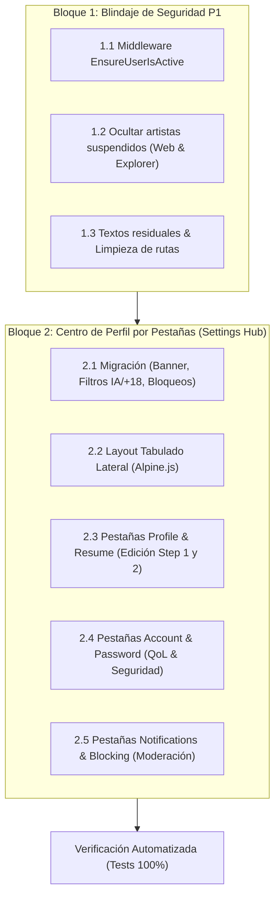

# Plan Integral de Implementación: Funciones y Mejoras P1

> **Documento Base:** [`A_Textos/Artfolio_Diagnostico_Mejoras_y_Nuevas_Funciones.pdf`](file:///c:/laragon/www/germanBianchi_artfolio/A_Textos/Artfolio_Diagnostico_Mejoras_y_Nuevas_Funciones.pdf)  
> **Estado del Proyecto:** ✅ 80 pruebas automatizadas aprobadas (100%), Bloque 1 (Blindaje de Seguridad & Suspensiones) y Bloque 2 (Settings Hub Estilo ArtStation, Flags IA y Bloqueo de Usuarios) completados con éxito.

---

## 1. Visión General del Plan P1

El objetivo de este plan es abordar de manera secuencial y ordenada las funciones de **Prioridad P1 (Crítica e Inmediata)** divididas en dos grandes bloques sinérgicos:

1. **Bloque 1 — Blindaje de Seguridad y Cierre de Estabilidad (Lista 1 - P1):**
   - Implementar la aplicación real de suspensiones de cuenta (middleware `EnsureUserIsActive` y filtrado público).
   - Limpieza de textos residuales en español y eliminación de rutas redundantes en papelera.
2. **Bloque 2 — Centro de Configuración y Gestión de Perfil por Pestañas (Lista 2 - P1 #2):**
   - Transformar la vista `/profile` en el *Settings Hub* por pestañas laterales inspirado en ArtStation ([`Art_profileTab1.png`](file:///c:/laragon/www/germanBianchi_artfolio/A_Textos/Art_profileTab1.png)): *Profile, Resume, Account (IA/+18), Notifications, Password y Blocking*.

---

## 2. Detalle de Implementación: Bloque 1 (Seguridad y Estabilidad)

### 📌 1.1 Middleware de Suspensión Activa (`EnsureUserIsActive`)
- **Archivo:** `app/Http/Middleware/EnsureUserIsActive.php`
- **Comportamiento:**
  - Si el usuario autenticado tiene `status === 'suspended'`:
    - Se cierra su sesión inmediatamente: `Auth::logout()`.
    - Se invalida la sesión y se regenera el token CSRF.
    - Se redirige a `/login` con mensaje de alerta en sesión:  
      *"Your account has been suspended by an administrator. Please contact support if you believe this is an error."*
  - Si intenta iniciar sesión con credenciales correctas pero su cuenta está suspendida, se bloquea el acceso en `AuthenticatedSessionController` informando el motivo.
- **Registro:** Se registra en el grupo `web` en `bootstrap/app.php`.

### 📌 1.2 Ocultamiento Público de Usuarios Suspendidos
- **Perfil Público ([`PublicProfileController.php`](file:///c:/laragon/www/germanBianchi_artfolio/app/Http/Controllers/PublicProfileController.php)):**
  - Cambiar `User::where('slug', $slug)->firstOrFail();` a:  
    `User::where('slug', $slug)->where('status', 'active')->firstOrFail();`
  - Si un usuario suspendido recibe visitas, el servidor devuelve un 404 limpio.
- **Explorador General ([`ExplorerController.php`](file:///c:/laragon/www/germanBianchi_artfolio/app/Http/Controllers/ExplorerController.php)):**
  - Asegurar que la consulta de obras públicas agregue:  
    `whereHas('user', fn($q) => $q->where('status', 'active'))` para que el arte de artistas sancionados no aparezca en la galería pública mientras dure la sanción.

### 📌 1.3 Limpieza Lingüística y Depuración de Rutas
- **Traducción de correo:** Traducir [`resources/views/emails/link-down-alert.blade.php`](file:///c:/laragon/www/germanBianchi_artfolio/resources/views/emails/link-down-alert.blade.php) al inglés (*"Broken Media Link Notice"*).
- **Tooltips:** En [`resources/views/components/viewer-modal.blade.php`](file:///c:/laragon/www/germanBianchi_artfolio/resources/views/components/viewer-modal.blade.php), cambiar `"Guardar a Favoritos"` por `"Save to Favorites"`.
- **Rutas de papelera:** En [`routes/web.php`](file:///c:/laragon/www/germanBianchi_artfolio/routes/web.php), remover las rutas heredadas obsoletas `papelera/{id}/restore` y `papelera/{id}` conservando únicamente las rutas tipadas de obras y colecciones.

---

## 3. Detalle de Implementación: Bloque 2 (Settings Hub por Pestañas)

### 📌 2.1 Base de Datos y Modelo
- **Nueva Migración:**
  - En `users`:
    - `banner_url` (`varchar(2048)`, nullable): Imagen panorámica de portada.
    - `show_mature_content` (`boolean`, default false): Filtro de contenido +18.
    - `hide_ai_content` (`boolean`, default false): Filtro para ocultar obras de IA.
    - `notify_new_artworks` (`boolean`, default true): Notificaciones de seguidos.
    - `notify_messages` (`boolean`, default true): Notificaciones de mensajes.
  - Nueva tabla `user_blocks`:
    - `id`, `user_id` (foreign key), `blocked_user_id` (foreign key), `timestamps`.
- **Actualización de [`User.php`](file:///c:/laragon/www/germanBianchi_artfolio/app/Models/User.php):**
  - Agregar campos a `$fillable` y `$casts`.
  - Relación `blockedUsers(): BelongsToMany`.
  - Helper `hasBlocked(int $userId): bool`.

### 📌 2.2 Layout Principal de Configuración ([`resources/views/profile/edit.blade.php`](file:///c:/laragon/www/germanBianchi_artfolio/resources/views/profile/edit.blade.php))
- **Estructura visual:** 
  - **Sidebar lateral izquierda:**
    - Mini tarjeta de identidad: Avatar circular, Nombre, *"Member since [Mes Año]"*.
    - Botones de pestañas estilizados con íconos SVG:
      1. 👤 **Profile** (Datos de Step 1 + Banner)
      2. 📄 **Resume** (Datos profesionales de Step 2)
      3. ⚙️ **Account** (Filtros IA/+18 + Borrado)
      4. 🔔 **Notifications** (Alertas)
      5. 🔒 **Password** (Cambio de clave)
      6. 🚫 **Blocking** (Gestión de bloqueados)
  - **Encabezado superior:** Botón de acción rápida **"View profile ↗"** que abre `/artista/{slug}`.
  - **Panel de contenido derecho:** Renderiza dinámicamente el contenido de la pestaña activa con transiciones fluidas de Alpine.js.

### 📌 2.3 Pestañas 1 (*Profile*) y 2 (*Resume*)
- **Profile:** Reutiliza de forma modular los componentes del Onboarding (Nombre, Headline, Ciudad, Selector dinámico de País y el editor de avatar Discord-style), agregando el campo para Cover Banner.
- **Resume:** Permite editar el slug público, biografía, etiquetas interactivas de *Skills* y *Software*, disponibilidad de comisiones, tipos de empleo y correo de contacto (de cuenta o personalizado).

### 📌 2.4 Pestañas 3 (*Account*) y 5 (*Password*)
- **Account:**
  - Toggles tipo switch para *Show Mature Content* y *Hide AI Content*.
  - En [`ExplorerController.php`](file:///c:/laragon/www/germanBianchi_artfolio/app/Http/Controllers/ExplorerController.php), si el usuario tiene activo `hide_ai_content`, se excluyen obras con etiqueta o categoría IA.
  - Zona de peligro con modal de confirmación por contraseña para eliminar cuenta.
- **Password:** Formulario existente de Breeze para actualizar contraseña con validación de seguridad.

### 📌 2.5 Pestañas 4 (*Notifications*) y 6 (*Blocking*)
- **Notifications:** Preferencias booleanas guardadas vía AJAX o formulario.
- **Blocking:**
  - Campo de texto con botón *"Block"* para ingresar un `@username`.
  - Validación: no se puede bloquear a uno mismo ni a administradores.
  - Lista de usuarios actualmente bloqueados con botón *"Unblock"*.
  - En la galería pública, las obras de usuarios bloqueados no se muestran al usuario que los bloqueó.

---

## 4. Estrategia de Pruebas y Control de Calidad

Se crearán tests dedicados en `tests/Feature/`:
1. `tests/Feature/UserSuspensionTest.php`:
   - Usuario suspendido es deslogueado automáticamente.
   - Usuario suspendido no puede iniciar sesión.
   - Perfil de usuario suspendido devuelve 404 a visitantes.
   - Obras de usuario suspendido no aparecen en el explorador.
2. `tests/Feature/SettingsHubTest.php`:
   - Actualización exitosa de pestañas Profile y Resume.
   - Guardado de preferencias de Account (+18 y filtro de IA).
   - Bloqueo y desbloqueo de usuarios con exclusión en la galería.

---

## 5. Preguntas Clave para el Usuario antes de Iniciar

1. **¿Prefieres abordar primero el Bloque 1 (Seguridad y Suspensión)** para dejar el backend blindado, y luego pasar al **Bloque 2 (Settings Hub por Pestañas)**?
2. En la pestaña **Account**, ¿deseas que el filtro *"No mostrar arte generado por IA"* filtre por una categoría específica (ej. `category == 'ai'`) o por tags que contengan `#ai` / `#ia`?

