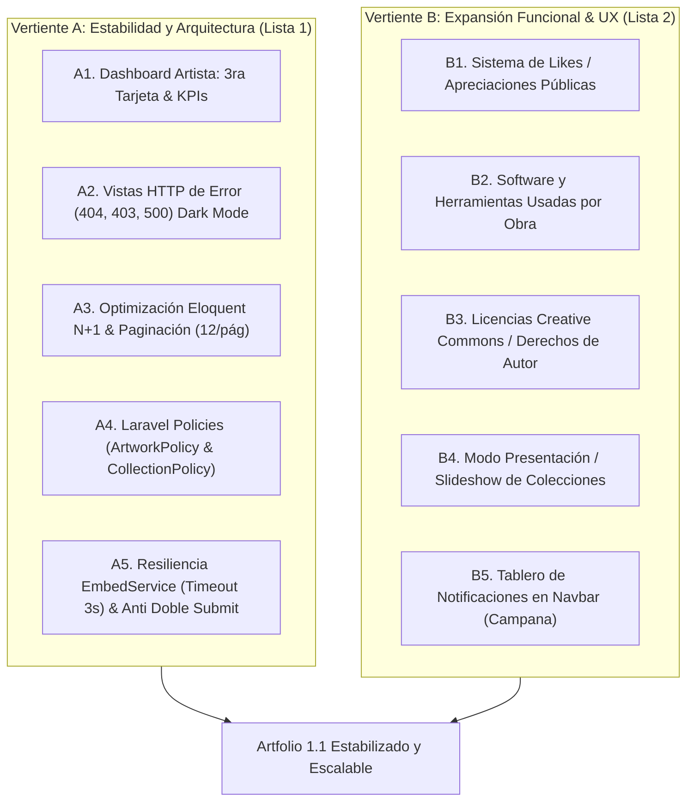

# Plan de Implementación: Prioridades P2 (Prioridad Alta) — Proyecto Artfolio

> **Documento de Referencia:** [`A_Textos/Artfolio_Diagnostico_Mejoras_y_Nuevas_Funciones.pdf`](file:///c:/laragon/www/germanBianchi_artfolio/A_Textos/Artfolio_Diagnostico_Mejoras_y_Nuevas_Funciones.pdf)  
> **Estado Base del Proyecto:** 80 pruebas automatizadas aprobadas (100%), Onboarding Inicial (3 pasos con middleware activo) y Centro de Configuración estilo ArtStation (*Settings Hub* con 6 pestañas) completados.

---

## 1. Visión General y Alcance de las Prioridades P2

Las prioridades **P2 (Prioridad Alta)** del diagnóstico se dividen en dos vertientes complementarias:

1. **Vertiente A: Estabilidad, Arquitectura y Robustez Interna (Lista 1: Ítems #7 al #14):**
   - Ajustes técnicos que protegen el rendimiento del servidor, eliminan cuellos de botella Eloquent (N+1), estandarizan la seguridad mediante Laravel Policies y elevan la calidad visual ante errores HTTP y paneles de control.
2. **Vertiente B: Nuevas Funcionalidades y Experiencia Creativa (Lista 2: Ítems #9 al #15):**
   - Herramientas sociales y de presentación que enriquecen las obras (sistema de apreciaciones públicas, software utilizado en la obra, licencias Creative Commons, visor en modo presentación y panel de notificaciones estilo *Art_NotificationBoard*).

---

## 2. Detalle de Ítems: Vertiente A (Estabilidad y Calidad de Código)

### 📌 A1. Dashboard Completo del Artista con KPIs (#7 Lista 1)
- **Problema actual:** `resources/views/dashboard.blade.php` tiene un contenedor `md:grid-cols-3` pero solo 2 tarjetas (*My Artworks* y *My Profile*), dejando un hueco asimétrico en pantallas medianas y grandes.
- **Solución:**
  1. Añadir la **3ra tarjeta**: *"My Collections & Bookmarks"* con accesos directos y contador.
  2. Implementar una **barra superior de métricas rápidas (KPIs del Artista)**:
     - Total de obras publicadas.
     - Total de colecciones activas.
     - Obras guardadas en favoritos.
     - Estado actual de comisiones con badge interactivo.

### 📌 A2. Páginas de Error Personalizadas (404, 403, 500) con Dark Mode (#8 Lista 1)
- **Problema actual:** Cuando un visitante accede a una URL inválida o se restringe el acceso a una obra ajena, Laravel renderiza la pantalla gris por defecto del framework.
- **Solución:**
  - Crear `resources/views/errors/404.blade.php` (Página no encontrada / Obra no disponible).
  - Crear `resources/views/errors/403.blade.php` (Acceso no autorizado o restringido).
  - Crear `resources/views/errors/500.blade.php` (Error de servidor inesperado).
  - Diseñadas con la identidad visual de Artfolio: tipografía Outfit/Inter, soporte completo para tema oscuro/claro y botón de retorno al explorador.

### 📌 A3. Optimización de Consultas Eloquent (N+1) y Paginación (#9 y #14 Lista 1)
- **Problema actual:**
  - `ArtworkController@index` y `CollectionController@index` ejecutan `->get()`, lo cual no escala si un artista tiene cientos de obras o colecciones.
  - En la galería pública y perfiles se pueden generar micro-consultas N+1 al iterar sobre usuarios y colecciones.
- **Solución:**
  - Cambiar `->get()` por `->paginate(12)` en `ArtworkController` y `CollectionController` con enlaces de paginación de Tailwind.
  - Eager loading preventivo: asegurar `with(['user', 'collections'])` en consultas de catálogo.

### 📌 A4. Estandarización de Seguridad con Laravel Policies (#10 Lista 1)
- **Problema actual:** Actualmente los controladores usan comprobaciones manuales como `abort_if($artwork->user_id !== auth()->id(), 403)`.
- **Solución:**
  - Crear `app/Policies/ArtworkPolicy.php` (`update`, `delete`, `restore`, `forceDelete`).
  - Crear `app/Policies/CollectionPolicy.php`.
  - Reemplazar las comprobaciones manuales por `$this->authorize('update', $artwork)` o `$user->can('update', $artwork)`.

### 📌 A5. Resiliencia de Red en `EmbedService` y Prevención de Doble Clic (#11 y #12 Lista 1)
- **Problema actual:** Si una API externa de oEmbed (YouTube, Sketchfab, etc.) está caída o responde lento, la solicitud del usuario puede colgarse. Además, envíos múltiples rápidos pueden crear registros duplicados.
- **Solución:**
  - Configurar `Http::timeout(3)->retry(1, 100)` en [`EmbedService.php`](file:///c:/laragon/www/germanBianchi_artfolio/app/Services/EmbedService.php) con captura silenciosa de excepciones hacia el fallback visual.
  - Añadir directiva Alpine `@submit="submitting = true"` y `:disabled="submitting"` en los botones de guardado de obras y colecciones.

---

## 3. Detalle de Ítems: Vertiente B (Nuevas Funcionalidades y Experiencia de Usuario)

### 🌟 B1. Sistema de Reconocimiento Público: Likes / "Appreciations" (#9 Lista 2)
- **Concepto:** En plataformas creativas como ArtStation o Behance, los **Favoritos** son colecciones privadas/personales de guardado, mientras que las **Apreciaciones / Likes** son reconocimientos públicos que alimentan el contador visible de popularidad de la obra.
- **Implementación:**
  - Tabla `artwork_likes` (`id`, `user_id`, `artwork_id`, `created_at`).
  - Relación `likes()` en `Artwork` y `likedArtworks()` en `User`.
  - Botón interactivo de "Like" (icono de pulgar arriba / aplauso) con contador en el visor modal y en la tarjeta.
  - Notificación opcional al autor cuando recibe un like.

### 🌟 B2. Software y Herramientas Utilizadas en la Obra (#10 Lista 2)
- **Concepto:** Permitir al artista detallar exactamente qué herramientas utilizó para crear la obra específica (ej. *Blender 4.0, ZBrush, Substance 3D Painter, Photoshop*).
- **Implementación:**
  - Columna JSON `software_used` en la tabla `artworks`.
  - Selector interactivo de etiquetas en `artworks/create` y `edit` (reutilizando el componente de pills ya implementado en el Resume del perfil).
  - Visualización en la ficha técnica del visor modal.

### 🌟 B3. Selector de Licencias Creative Commons & Derechos de Autor (#14 Lista 2)
- **Concepto:** Ofrecer seguridad jurídica al creador especificando las condiciones de uso de su trabajo.
- **Opciones de Licencia:**
  1. *All Rights Reserved (Todos los derechos reservados - Predeterminada)*.
  2. *Creative Commons BY (Atribución)*.
  3. *Creative Commons BY-NC (Uso No Comercial)*.
  4. *Creative Commons BY-NC-ND (No Comercial - Sin Derivadas)*.
  5. *Public Domain / CC0*.
- **Implementación:**
  - Columna `license` (enum o varchar) en `artworks`.
  - Selector visual con badges e iconos informativos en el formulario y en el visor modal.

### 🌟 B4. Modo Presentación / Slideshow a Pantalla Completa (#13 Lista 2)
- **Concepto:** Permitir a los evaluadores, clientes o al propio artista proyectar las obras de una colección en pantalla completa de forma secuencial con controles de avance (siguiente, anterior, pausa/reproducción).
- **Implementación:**
  - Componente Alpine.js en la vista pública de la colección (`collections/show.blade.php`) activable con botón *"Slideshow View / Modo Presentación"*.
  - Atajos de teclado: flechas izquierda/derecha para navegar y tecla Escape para salir.

### 🌟 B5. Centro de Notificaciones en Navbar (Campana / *Art_NotificationBoard*) (#15 Lista 2)
- **Concepto:** Notificar en tiempo real al artista dentro de la plataforma sobre:
  - Alguien guardó su obra en Favoritos.
  - Alguien le dio "Like" o apreciación a su obra.
  - El administrador resolvió un reporte sobre un enlace de su obra.
- **Implementación:**
  - Uso del sistema nativo de Laravel `Illuminate\Notifications\DatabaseNotification`.
  - Icono de campana en el navbar con indicador rojo de notificaciones no leídas.
  - Menú desplegable interactivo para marcar como leídas e ir directamente a la obra relacionada.

---

## 4. Fases de Ejecución Recomendadas

Para mantener el código ordenado y validar cada paso con pruebas automatizadas, se sugiere ejecutar en **3 fases**:

| Fase | Foco Principal | Ítems Comprendidos | Entregables Clave |
| :--- | :--- | :--- | :--- |
| **Fase 1: Calidad y Resiliencia del Núcleo** | Estabilidad y Arquitectura | A1, A2, A3, A4, A5 | Dashboard 3 columnas con KPIs, vistas de error 404/403/500, Policies oficiales, paginación y timeout en EmbedService. |
| **Fase 2: Ficha Técnica y Derechos de la Obra** | Enriquecimiento de Obras | B2, B3, B1 | Columna y selector de software utilizado, selector de licencias Creative Commons y sistema de Likes/Apreciaciones. |
| **Fase 3: Experiencia Social y Presentación** | Interacción y Difusión | B4, B5 | Modo Slideshow a pantalla completa para colecciones y panel de notificaciones (campana) en la barra de navegación. |
