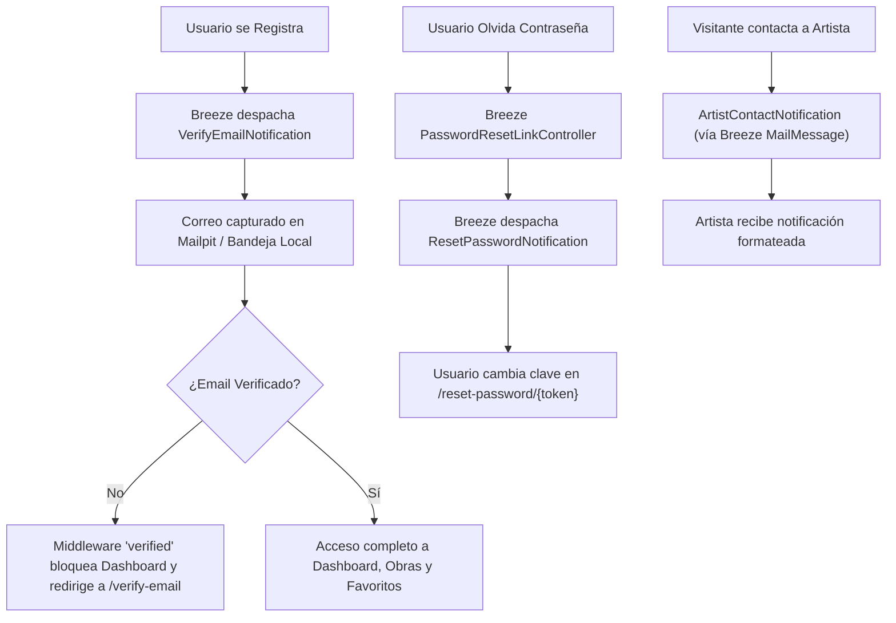

# Plan de Implementación: Sistema de Correos con Laravel Breeze

## 1. Visión General del Enfoque

En lugar de construir controladores y clases Mailable dispersas o depender de servicios externos complejos en etapas tempranas, este plan propone **aprovechar y extender la infraestructura nativa de Laravel Breeze**.

Laravel Breeze no solo proporciona vistas de autenticación, sino que incluye un ecosistema completo para:
1. **Verificación de dirección de correo electrónico (`MustVerifyEmail`)**.
2. **Recuperación segura de contraseñas (`Forgot Password` / `Reset Password`)**.
3. **Re-verificación automática al actualizar la dirección en el perfil**.
4. **Sistema estandarizado de notificaciones (`MailMessage`)**: Permite unificar cualquier otro correo de la aplicación (como el contacto a artistas o alertas de moderación) bajo la misma plantilla visual, limpia y responsiva oficial de Laravel/Breeze.

---

## 2. Fases de Implementación



---

### Fase 1: Activación del Núcleo de Correo de Breeze (Auth)

1. **Habilitar `MustVerifyEmail` en el Modelo `User`**:
   - En `app/Models/User.php`, implementar la interfaz `Illuminate\Contracts\Auth\MustVerifyEmail`.
   - Esto activa el escucha de eventos de Breeze `SendEmailVerificationNotification` cuando se dispara `Registered`.

2. **Protección de Rutas Críticas con Middleware `verified`**:
   - En `routes/web.php`, aplicar `verified` a:
     - `/dashboard` (ya preparado).
     - Creación y edición de obras (`artworks.create`, `artworks.store`, `artworks.edit`, `artworks.update`).
     - Creación de colecciones (`collections.create`, `collections.store`).
   - Los usuarios no verificados podrán explorar la galería pública pero no podrán publicar ni alterar contenido hasta validar su cuenta.

3. **Re-verificación al Modificar el Email**:
   - Breeze ya contempla en `ProfileController.php` que si el email cambia, se anula `email_verified_at = null`.
   - La vista `resources/views/profile/partials/update-profile-information-form.blade.php` ya tiene el bloque condicional para advertir al usuario y ofrecerle reenviar el link con un solo clic.

4. **Revisión Estética y Coherencia de Vistas Breeze**:
   - Verificar que `resources/views/auth/verify-email.blade.php`, `forgot-password.blade.php` y `reset-password.blade.php`:
     - Utilicen el componente `<x-theme-toggle />` (Modo Oscuro / Claro).
     - Mantengan textos en inglés consistentes con el resto de la aplicación.
     - Botones y estilos alineados con la identidad visual de Artfolio (Índigo/Púrpura).

---

### Fase 2: Unificación de Notificaciones al Estilo Breeze (`MailMessage`)

Para reincorporar el contacto y las alertas de moderación sin romper la simplicidad arquitectónica requerida para la facultad:

1. **Contacto al Artista (`App\Notifications\ArtistContactNotification`)**:
   - En lugar de un controlador y mailable complejos, creamos una Notificación de Laravel:
     ```php
     class ArtistContactNotification extends Notification
     {
         public function toMail(object $notifiable): MailMessage
         {
             return (new MailMessage)
                 ->subject("New Inquiry: {$this->subject}")
                 ->greeting("Hello {$notifiable->name}!")
                 ->line("You have received a new inquiry from {$this->senderName} ({$this->senderEmail}):")
                 ->line("\"{$this->message}\"")
                 ->action('View Artist Dashboard', route('dashboard'))
                 ->line('Thank you for being part of Artfolio!');
         }
     }
     ```
   - **Ventaja**: Utiliza exactamente el mismo diseño, tipografía y estilo visual HTML de los correos de Breeze (`VerifyEmail` y `ResetPassword`).

2. **Reincorporación Simplificada en el Perfil Público (`resources/views/profile/show.blade.php`)**:
   - Reinsertar el botón **"Contact Artist"** únicamente para usuarios autenticados y verificados.
   - Para visitantes no autenticados, activar el modal `open-guest-modal` indicando que deben iniciar sesión para contactar.
   - Formulario modal simple y limpio con validación en `ContactController@send`.
   - Regla de negocio: Bloquear auto-contacto (`auth()->id() !== $artist->id`).

3. **Alerta de Moderación de Enlaces Caídos (`App\Notifications\LinkDownAlertNotification`)**:
   - Reemplazar el mailable manual por una notificación similar, manteniendo consistencia en toda la aplicación.

---

### Fase 3: Entorno de Ejecución y Pruebas Locales (Mailpit)

1. **Garantizar Captura en Desarrollo**:
   - En el archivo `.env`, asegurar la configuración de desarrollo:
     ```env
     MAIL_MAILER=smtp
     MAIL_HOST=127.0.0.1
     MAIL_PORT=1025
     MAIL_USERNAME=null
     MAIL_PASSWORD=null
     MAIL_FROM_ADDRESS="no-reply@artfolio.test"
     MAIL_FROM_NAME="Artfolio"
     ```
   - **Beneficio para evaluación académica**: Los profesores pueden probar el registro, la verificación y el contacto abriendo la interfaz web de Mailpit en `http://127.0.0.1:8025` sin necesidad de internet ni de ingresar credenciales privadas de Gmail/Brevo.

2. **Comando de Diagnóstico Artisan**:
   - Mantener el comando `php artisan mail:test {email?}` en `routes/console.php` para verificar con un comando la salud del sistema de correos.

---

### Fase 4: Batería de Pruebas Automatizadas (PHPUnit)

Añadir y actualizar tests en `tests/Feature/`:
1. `tests/Feature/Auth/EmailVerificationTest.php`: Verificar que el registro envía el link de verificación y que el middleware `verified` protege las rutas.
2. `tests/Feature/Auth/PasswordResetTest.php`: Verificar que el flujo de recuperación de contraseña de Breeze funciona de punta a punta.
3. `tests/Feature/ArtistContactTest.php`: Verificar que usuarios verificados pueden enviar consultas, que los invitados reciben redirección o 401, y que el auto-contacto está bloqueado.
4. **Criterio de éxito**: 100% de tests aprobados (`php artisan test`).

---

## 3. Comparativa: Enfoque Anterior vs. Enfoque Breeze

| Característica | Enfoque Anterior | Enfoque Propuesto con Laravel Breeze |
| :--- | :--- | :--- |
| **Arquitectura** | Mailables personalizados sueltos | Notificaciones nativas (`MailMessage`) de Breeze |
| **Verificación de Email** | Desactivada | Nativa de Breeze con `MustVerifyEmail` |
| **Recuperación de Clave** | Presente pero sin probar | Integrada en el mismo canal visual de correos |
| **Estilo Visual del Email** | Plantillas Blade custom | Plantilla oficial responsiva de Laravel/Breeze |
| **Complejidad de Código** | Media (muchos archivos ad-hoc) | Mínima y estándar (fácil de defender ante profesores) |
| **Pruebas Académicas** | Dependía de configuración SMTP externa | 100% auditable en local con Mailpit |

---

## 4. Preguntas para Alineación

Antes de iniciar la ejecución, por favor indícame:
1. **¿Deseas que activemos la verificación obligatoria de correo (`MustVerifyEmail`) al registrarse?** (Esto impedirá subir obras hasta hacer clic en el enlace de verificación).
2. **¿Reincorporamos el botón de contacto en el perfil del artista bajo este nuevo formato de notificación unificada de Breeze?**
3. **¿Procedemos con la implementación paso a paso según este plan?**

