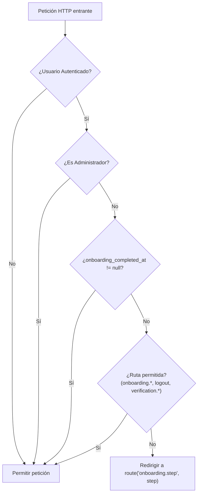

# Plan de Implementación: Asistente de Onboarding Inicial en 3 Etapas (Estilo ArtStation)

## 1. Visión General y Objetivos

Este plan describe la arquitectura, diseño y etapas de desarrollo para incorporar un **Asistente de Onboarding Inicial Obligatorio** en Artfolio. El objetivo es ofrecer a todo usuario recién registrado una experiencia guiada (First-Time User Experience - FTUE) idéntica a los estándares de la industria creativa (**ArtStation**, **Behance**), garantizando que ningún artista deje su perfil vacío o sin avatar.

### Requisitos Clave:
1. **Flujo de 3 Etapas:**
   - **Paso 1 (Información Básica):** Headline profesional, Ciudad, País, Zona horaria/Idioma y Avatar (con recorte o URL externa).
   - **Paso 2 (Perfil Profesional):** Username/Slug público verificado en vivo, Biografía/Resumen, Especialidades (Skills), Software de dominio, Disponibilidad para comisiones y visibilidad de contacto.
   - **Paso 3 (Éxito y Lanzamiento):** Mensaje de felicitaciones con resumen visual y botón destacado de redirección a la Homepage de Artfolio.
2. **Intercepción y Bloqueo Obligatorio:**
   - Si los pasos 1 y 2 no se han completado, **el usuario no puede navegar a ninguna otra página de la aplicación**.
   - Si cierra la sesión o el navegador, al volver a iniciar sesión (*re-login*) el sistema detecta su progreso y lo redirige de inmediato al paso en el que se quedó.

---

## 2. Arquitectura de Datos y Migración

### Migración: `add_onboarding_and_professional_fields_to_users_table`

Añadirá las siguientes columnas a la tabla `users`:

```php
Schema::table('users', function (Blueprint $table) {
    // Campos del Paso 1
    $table->string('headline', 120)->nullable()->after('name'); // Ej: "3D Character Sculptor"
    $table->string('city', 100)->nullable()->after('headline');
    $table->string('country', 100)->nullable()->after('city');

    // Campos del Paso 2
    $table->json('skills')->nullable()->after('bio');         // Array de tags: ["3D Modeling", "Concept Art"]
    $table->json('software')->nullable()->after('skills');     // Array de software: ["Blender", "ZBrush"]
    $table->json('hiring_types')->nullable()->after('software'); // ["Freelance", "Contract", "Full-time"]
    $table->boolean('public_email_enabled')->default(false)->after('hiring_types');

    // Control de Estado del Onboarding
    $table->unsignedTinyInteger('onboarding_step')->default(1)->after('status');
    $table->timestamp('onboarding_completed_at')->nullable()->after('onboarding_step');
});
```

*Nota:* Los usuarios seeders existentes (`DemoContentSeeder` y `AdminSeeder`) se marcarán automáticamente con `onboarding_completed_at = now()` para no interrumpir cuentas de prueba ni al administrador.

---

## 3. Middleware de Intercepción: `EnsureOnboardingCompleted`

Para cumplir con la regla de bloqueo estricto, se creará el middleware `app/Http/Middleware/EnsureOnboardingCompleted.php`.

### Lógica de Decisión:



### Registro en Laravel 11 (`bootstrap/app.php`):
Se registrará en el grupo de middlewares web mediante `$middleware->web(append: [EnsureOnboardingCompleted::class])`.

---

## 4. Rutas y Controlador (`OnboardingController`)

### Rutas (`routes/web.php`):
Todas bajo el grupo `middleware(['auth'])`:
- `GET /onboarding/step/{step}` (`onboarding.step`): Muestra la vista correspondiente (1, 2 o 3).
- `POST /onboarding/step/1` (`onboarding.step1.save`): Valida y guarda Paso 1, actualiza `onboarding_step = 2`.
- `POST /onboarding/step/2` (`onboarding.step2.save`): Valida y guarda Paso 2, actualiza `onboarding_step = 3`.
- `POST /onboarding/complete` (`onboarding.complete`): Establece `onboarding_completed_at = now()`, redirige a `route('home')`.
- `GET /onboarding/check-username` (`onboarding.checkUsername`): Endpoint AJAX rápido para verificar disponibilidad del slug en tiempo real.

---

## 5. Diseño de las Vistas (Estilo ArtStation con Tailwind & Alpine.js)

Se creará una plantilla dedicada: `resources/views/layouts/onboarding.blade.php`.
- **Diseño enfocado:** Sin menú de navegación tradicional ni distracciones, fondo oscuro elegante (`bg-gray-900`) con soporte modo claro.
- **Barra de Progreso Superior:** Indicador claro con 3 etapas numeradas:
  1. *Personal Profile*
  2. *Professional Profile*
  3. *Launch*

### Paso 1: `resources/views/onboarding/step1.blade.php`
- Headline / Título breve (\*)
- Ciudad (\*) y País (\*) con selector de banderas o listado estándar.
- Avatar uploader con previsualización circular y modal de recorte o enlace URL directo.
- Preferencia de idioma y notificaciones.
- Botón: *"Continue to Professional Profile →"*.

### Paso 2: `resources/views/onboarding/step2.blade.php`
- **Username / URL pública (\*):** Input con prefijo `artfolio.test/artista/` y validación en vivo con debounce de Alpine.js mostrando check verde o aviso de duplicado.
- **Resumen Profesional (\*):** Textarea con contador de caracteres.
- **Skills & Software:** Chips interactivos con autocompletado y botón de eliminar tag `(X)`.
- **Comisiones y Empleo:** Selector de comisiones (`open`, `consult`, `closed`) y checkboxes para modalidades de trabajo (*Freelance*, *Contract*, *Full-time*).
- **Visibilidad de contacto:** Toggle para mostrar o no el email en el perfil público.
- Botones: *"← Back to Step 1"* y *"Finish & Create Profile →"*.

### Paso 3: `resources/views/onboarding/step3.blade.php`
- Icono de éxito o animación con confetti ligero.
- Mensaje de bienvenida personalizado: *"You're all set, [Name]!"*.
- Tarjeta de vista previa resumen del perfil recién configurado.
- Botón principal de llamada a la acción (CTA): **"Explore Homepage / Discover Art →"** hacia la portada.

---

## 6. Pruebas Automatizadas (Feature Testing)

Se creará la suite `tests/Feature/OnboardingWizardTest.php` con los siguientes casos de prueba:
1. **`test_uncompleted_user_is_redirected_to_onboarding_from_dashboard`**: Un usuario recién registrado que intenta entrar a `/dashboard` es redirigido a `/onboarding/step/1`.
2. **`test_step1_validation_and_advancement`**: Se guardan los datos básicos del paso 1 y el estado pasa al paso 2.
3. **`test_step2_validates_unique_username_and_saves_profile`**: Se valida la unicidad del slug y se guardan las habilidades.
4. **`test_user_is_locked_into_onboarding_on_relogin`**: Si un usuario cierra sesión a la mitad del onboarding y vuelve a autenticarse, sigue bloqueado en el onboarding.
5. **`test_completing_onboarding_allows_free_navigation_and_redirects_to_home`**: Al finalizar, `onboarding_completed_at` se registra y el usuario puede acceder libremente a cualquier ruta.
6. **`test_admin_bypasses_onboarding`**: El administrador no es interceptado por el wizard.

---

## 7. Plan de Ejecución Paso a Paso

| Fase | Tarea | Entregables |
| :-: | :--- | :--- |
| **Fase 1** | Migración de base de datos | Migración con nuevos campos y actualización de seeders. |
| **Fase 2** | Middleware interceptor | Creación de `EnsureOnboardingCompleted` y registro en `bootstrap/app.php`. |
| **Fase 3** | Controlador y Validación | `OnboardingController`, Requests con reglas de validación y verificación de slug AJAX. |
| **Fase 4** | Vistas Blade & UX | Layout de onboarding y las 3 vistas de etapa con Alpine.js. |
| **Fase 5** | Tests & Verificación | Creación de `OnboardingWizardTest.php` (6 tests) y ejecución de la suite completa. |
