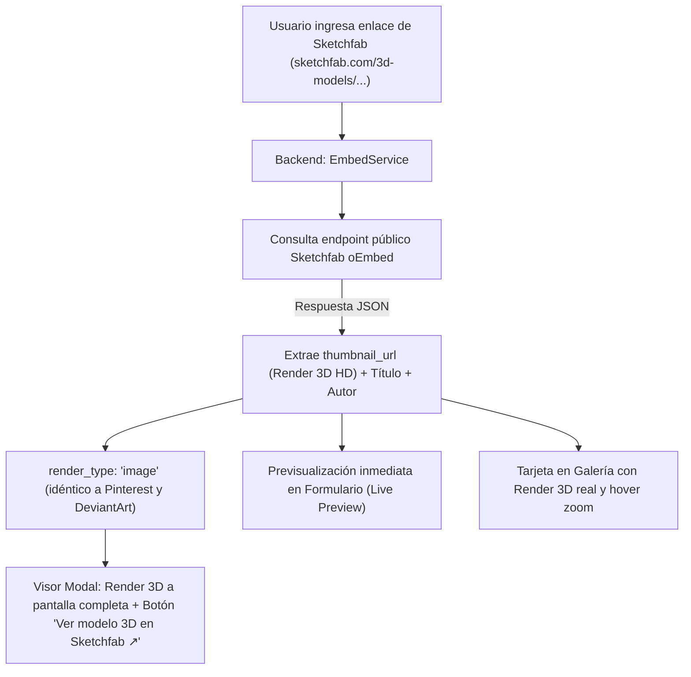

# 🧊 Plan de Implementación: Extracción y Vista Previa de Modelos 3D de Sketchfab

## 1. Diagnóstico del Estado Actual en Artfolio

Actualmente, cuando un artista ingresa un enlace de Sketchfab (ej: `https://sketchfab.com/3d-models/...` o `https://sketchfab.com/models/...`):

1. **Sin imagen de vista previa:** [EmbedService.php](file:///c:/laragon/www/germanBianchi_artfolio/app/Services/EmbedService.php) no consulta metadatos de Sketchfab, dejando `thumbnail_url` en `null`.
2. **Tarjeta de la galería sin portada real:** En la galería principal ([artwork-card.blade.php](file:///c:/laragon/www/germanBianchi_artfolio/resources/views/components/artwork-card.blade.php)), al no existir miniatura, se muestra un ícono gris genérico de cubo 3D.
3. **Formulario sin feedback visual:** En los formularios de publicar y editar ([create.blade.php](file:///c:/laragon/www/germanBianchi_artfolio/resources/views/artworks/create.blade.php) y [edit.blade.php](file:///c:/laragon/www/germanBianchi_artfolio/resources/views/artworks/edit.blade.php)), el usuario no ve ninguna previsualización del modelo antes de guardar.
4. **Visor modal:** Intenta generar un iframe que a menudo consume muchos recursos de WebGL en segundo plano, en lugar de mostrar una imagen de presentación limpia con opción directa de visita al modelo original.

---

## 2. Verificación Técnica de la API de Sketchfab

Sketchfab implementa el protocolo estándar abierto **oEmbed**, de acceso **público, gratuito y anónimo** (sin necesidad de API keys, tokens ni cuentas de desarrollador):

```text
GET https://sketchfab.com/oembed?url=https://sketchfab.com/models/dGUrytaktlDeNudCEGKk31oTJY
```
*(También compatible con URLs modernas del tipo `https://sketchfab.com/3d-models/[slug]-[id]`)*

### Datos comprobados en pruebas técnicas reales:
- **`thumbnail_url`:** Devuelve una captura en alta resolución del render 3D (ej: `https://media.sketchfab.com/models/.../thumbnails/.../9d65f2da...jpeg` a 720p).
- **`title`:** Título exacto de la obra 3D.
- **`author_name`:** Nombre del autor o estudio 3D.
- **`author_url`:** Enlace directo al perfil del artista en Sketchfab.
- **Respaldo en OpenGraph (`og:image`):** La página web de Sketchfab expone en sus etiquetas meta una imagen a resolución **1024x768**, garantizando un fallback de máxima nitidez.

---

## 3. Plan de Implementación Propuesto



### Fase 1: Actualización del Servicio de Extracción (`EmbedService.php`)
1. **Detección del Proveedor:** Asegurar que `determineProvider` reconozca todas las variantes de dominio de Sketchfab (`sketchfab.com`, `www.sketchfab.com`).
2. **Método `fetchSketchfabData(string $url): array`:**
   - Realizar petición HTTP GET a `https://sketchfab.com/oembed?url=...` con timeout controlado (5s).
   - Extraer `thumbnail_url`, `title` y `author_name`.
   - Si el título y el autor existen, generar el título compuesto: *`"[Título]" - por [Autor]`*.
   - Si oEmbed no respondiera, activar fallback secundario mediante lectura de `<meta property="og:image">` en el HTML.
3. **Mapeo de Atributos:**
   - `category` = `'3d'` (para que el filtro de la galería "Modelado 3D" siga funcionando perfectamente).
   - `render_type` = `'image'` (para renderizado nativo limpio en el modal).
   - `thumbnail_url` = URL directa de la imagen del render en `media.sketchfab.com`.
   - `embed_html` = `null` (o preservado como opción secundaria).

### Fase 2: Previsualización en Tiempo Real en Formularios (`create.blade.php` y `edit.blade.php`)
1. Al escribir o pegar un enlace de Sketchfab en el campo *Enlace Multimedia*:
   - El endpoint `/artworks/preview-url` responde con los datos del modelo 3D.
   - La tarjeta de vista previa muestra la imagen del render 3D.
   - Muestra el distintivo: *"Render 3D (Sketchfab)"*.
   - Autocompleta el título del modelo si el campo estaba vacío.
   - Autoselecciona la categoría **Modelado 3D** automáticamente.

### Fase 3: Visor Modal (`viewer-modal.blade.php`)
1. Adaptar el visor modal para reconocer a Sketchfab:
   - Presenta la imagen del render 3D a pantalla completa sin distracciones ni cargas lentas.
   - En la esquina inferior muestra el botón de atribución con la identidad de Sketchfab:
     **"Ver modelo 3D en Sketchfab ↗"** con estilo azul característico de la plataforma (`bg-[#1caad9] hover:bg-[#1594be] text-white`).

### Fase 4: Tarjetas de la Galería Principal (`artwork-card.blade.php`)
1. Al contar ahora con `thumbnail_url`, las obras 3D mostrarán automáticamente la imagen real del render con transición y zoom suave al pasar el cursor, reemplazando el icono gris genérico.

---

## 4. Opciones para tu Decisión

Antes de implementar, te presento dos opciones para el comportamiento del visor modal:

- **Opción A (Recomendada - Idéntica a Pinterest y DeviantArt):**
  El modal muestra la imagen del render 3D en alta resolución a pantalla completa y el botón destacado *"Ver modelo 3D en Sketchfab ↗"*. Es extremadamente rápido, ligero para el navegador y no consume memoria gráfica hasta que el usuario decide abrir el modelo interactivo en Sketchfab.

- **Opción B (Híbrida con botón de incrustación interactiva):**
  Muestra la imagen del render 3D, pero incluye un botón adicional en el visor que dice *"Cargar visor interactivo 3D aquí"* para incrustar el iframe sólo si el usuario lo solicita explícitamente.
